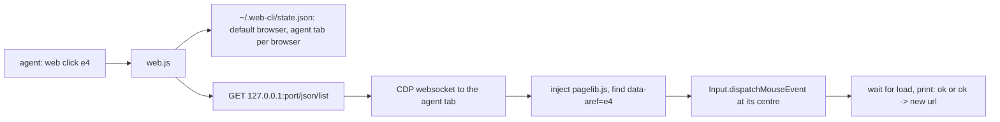

# web

A browser CLI built for AI agents. It drives Opera GX, Chrome or Edge over the Chrome DevTools Protocol (CDP), and prints compact text instead of full accessibility snapshots, so an agent spends far fewer tokens per step than with a browser MCP.

- No dependencies. One Node 22+ script (uses the built-in `WebSocket` and `fetch`).
- Works while the browser is minimized or behind other windows. You keep using your PC.
- Never touches your own tabs or your everyday browser profile.

## Install

```
git clone <this repo> ~/.claude/tools/web
```

Then put a shim on `PATH`:

- `web.cmd` (PowerShell / cmd): `@node "%USERPROFILE%\.claude\tools\web\web.js" %*`
- `web` (Git Bash / sh): `#!/bin/sh` + `exec node "$HOME/.claude/tools/web/web.js" "$@"`

Or `npm install -g .` from the repo, which uses the `bin` entry in `package.json`.

Check it: `web selftest` (and `web selftest --minimized`).

## How it works



- **One process per call.** It connects, acts, prints and exits. A local connection takes about 50ms. There's no daemon to keep alive.
- **Refs live in the DOM.** `page` and `find` tag elements with `data-aref="eN"`, so a ref from one call still works in the next. If the page re-rendered and the element is gone, you get `stale ref eN, run web find or web page again`.
- **Dedicated profiles.** Each browser runs from `~/.web-cli/profiles/<browser>` on its own port (opera 9222, chrome 9223, edge 9224). Chromium refuses debug ports on the default profile, and this also keeps your real profile unlocked. Log in once inside the agent's window and the session persists.
- **Its own tab.** The first call opens an agent tab and remembers its id. `web tabs` lists everything in that browser. `--tab <id>` acts on any other tab for one call, and `web use <id>` makes another tab the agent tab.
- **Your logins.** `web clone [browser]` copies cookies, saved passwords, site storage and extensions from your real profile into the agent profile. Close the real browser for this, because Chromium locks the cookie DB and (since 136) refuses a debug port on the default profile. It's a snapshot: re-run it after you log into something new. Device-bound sessions (some Google logins) may not carry over.
- **Background-safe.** Focus emulation is on, clicks are synthetic CDP input, and the OS cursor never moves. `shot` is the one exception: a minimized window renders no frames, so `shot` restores the window, captures and minimizes it again.

## Commands

Global flags: `--b opera|chrome|edge` (default: last `web up`, initially opera) and `--tab <id prefix>`.

| Command | Prints |
|---|---|
| `up [browser]` | `up opera :9222`, starting the browser if needed. Also sets the default browser. |
| `tabs` | `* 76A9F9 Title  url`, one line per tab. `*` is the agent tab. |
| `open [url]` | Opens a new agent tab (and navigates if a URL is given). |
| `goto <url> [--quiet] [--t s]` | `ok <url> "<title>"` plus the first 40 outline lines. `--quiet` prints only the first line. |
| `page` | The whole page as an outline (see below). |
| `page --region main\|nav\|form\|dialog\|header\|footer\|<ref>` | Just that subtree. |
| `page --sel <css>` | The subtree matching a CSS selector. |
| `page --expand <ref>` | A folded group, unfolded. |
| `page --max N` / `--raw` | Changes the budget (default 8000 chars) / no budget and no folding. |
| `snap` (= `page -i`) | Only refs, headings and landmarks. |
| `find <text>` | Matching interactive elements as refs. If none match, falls back to text matches. |
| `find button:Send`, `find textbox:`, `find link:Home` | Filters by role. |
| `text [--sel css] [--max N]` | Visible text (default max 4000 chars). |
| `click <ref>` | `ok`, or `ok -> <new url>`. Says `(js click, covered by X)` if something was on top of the element. |
| `hover <ref>` | `ok` |
| `type <ref> <text> [--clear] [--enter]` | `ok`. Real text input, so React and Vue see it. |
| `select <ref> <option text or value>` | `ok <chosen option>` |
| `key <Enter\|Tab\|Escape\|ArrowDown\|Control+a\|...>` | `ok` |
| `scroll [down\|up\|<ref>]` | `ok <pos>/<max>`. Falls back to the largest inner scroller when the window can't scroll. |
| `wait <text\|ref\|url:part\|gone:text> [--t 10]` | `ok`, or a timeout error. |
| `eval <js expression>` | The value, truncated at 4000 chars. Promises are awaited. |
| `shot [ref] [--o file]` | The PNG path only. Images are never printed inline. |
| `net [--filter s] [--n 30]` | `200 fetch 1.2kb 45ms url`, from the Resource Timing API. |
| `console [--all]` | Errors and warnings logged since the page loaded. |
| `back`, `reload`, `close`, `use <id>` | Navigation and tab management. |
| `do` | Runs commands from stdin, one per line, in one process. Stops at the first error. |
| `clone [browser]` | Copies logins from your real profile. The real browser must be closed. |
| `selftest [--minimized]` | 20 checks on a local page in a throwaway tab. Exits 0 when all pass. |

Errors go to stderr as one line with exit code 1, and they say what to do next.

## The outline (`web page`)

```
@ https://news.ycombinator.com/ "Hacker News"
[e3 link "new"]
table 92x3:
  | 1. | [e11 link "" vote?id=…] | [e12 link "Show HN: …"] ( [e13 link "hackerbooks.org"] )
  |  | 1629 points by [e14 link "roansh"] [e15 link "22 hours ago"] | [e17 link "268 comments"]
  …+10 similar (web page --expand e231)
form:
  Search:
  [e28 textbox "" =""]
```

- `[eN role "name" state]` is an element you can act on. The state part is `="value"` for textboxes and selects, `[x]`/`[ ]` for checkboxes, and `disabled` when it applies. Unnamed links show their href.
- `#`, `##` and so on are headings. `nav:`, `main:`, `form "Search":` and `dialog:` are landmarks, with their content indented.
- `table RxC:` marks a data table, one row per line. Layout tables (nested tables or big cells) are walked like divs instead.
- Text is clipped (120 chars per text piece, 60 per element name). Hidden elements, scripts, SVG and pure punctuation are dropped.
- **Folding happens only when the page is over budget.** If everything fits in `--max`, you get everything. Otherwise repeated sibling shapes are folded, including alternating patterns like story/subtext/spacer rows. Each group keeps as many items as fit (40, 20, 10, then 5), followed by `…+N similar (web page --expand eK)`.

## Agent loop

1. `web goto <url>`. The output already includes the top of the page.
2. Not enough to act on? Run `web page`, or `web page --region main`.
3. Act on a ref: `click`, `type` or `select`.
4. After a click prints `ok -> <url>`, run `web page` again. After a partial update, use `web page --region <ref>` or `web find <target>`.
5. Batch known sequences:

```
web do <<'EOF'
goto example.com/login --quiet
type e4 me@example.com
type e5 hunter2 --enter
wait url:/dashboard
EOF
```

## Limits

- **Main frame only.** iframes show as `iframe "src"`. Add `--frame` when a site needs it.
- **Open Shadow DOM isn't traversed.** Use `eval` for web-component-heavy pages.
- **One agent tab per browser.** Parallel agents would share it; use `--tab`, or `open` per agent.
- **Firefox isn't supported.** It doesn't speak CDP.
- `console` reports what the browser buffered since page load. Messages from before the last navigation are gone.

## Files

| File | Role |
|---|---|
| `web.js` | CLI, CDP client, browser launch, commands |
| `pagelib.js` | Injected into the page: outline, refs, find, click points |
| `selftest.js` | End-to-end checks |
| `SKILL.md` | Instructions for Claude Code agents |
