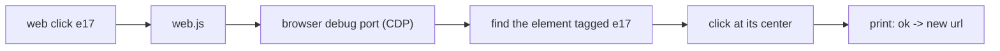

<div align="center">


## The CLI alternative to Playwright MCP

#### *Playwright wrote MCP. We wrote the CLI.*

**Token-lean browser control for AI agents, on the Opera, Chrome or Edge you already use.**

[](LICENSE)
[](https://nodejs.org)
[](package.json)
[](selftest.js)


[Install](#-install) · [Quick start](#-quick-start) · [Commands](#-commands) · [vs Playwright MCP](#-why-not-playwright-mcp) · [How it works](#-how-it-works)

</div>

---

Playwright MCP is great until you watch your agent use it: a full page snapshot after every click, thousands of tokens per step, a browser it launches itself, and no easy way to use the Opera you're already logged into.

**playwrote** does the same job as a plain shell command, `web`. Your agent reads a page, gets short refs like `e17`, and acts on them. Every reply is a few lines, not a few thousand tokens.

> [!NOTE]
> Not affiliated with Playwright or Microsoft. Just inspired by them, and slightly fed up with token bills.

## ✨ Highlights

|  |  |
|---|---|
| 🪶 **Token-lean** | `click` prints `ok`. A full Hacker News front page outline is about 6k characters. |
| 👻 **Runs in the background** | Works with the window minimized. Never moves your mouse. Keep using your PC. |
| 🔑 **Your logins** | `web clone` copies the logins from your normal browser profile into the agent's profile. |
| 🧩 **Any Chromium browser** | Opera (incl. GX), Chrome, Edge. Your pick, per call. |
| 📦 **Zero dependencies** | One Node script. No Playwright install, no browser downloads. |
| 🔁 **Batching** | `web do` runs a whole login flow in a single tool call. |

## 🚀 Install

```bash
npm install -g github:Abedishere/playwrote-cli
web selftest        # -> selftest ok (20/20)
```

The first command opens a separate browser window that belongs to the agent. Your own windows and tabs are left alone.

## ⚡ Quick start

```console
$ web goto news.ycombinator.com
ok https://news.ycombinator.com/ "Hacker News"
[e3 link "new"] [e4 link "past"] [e10 link "login"]
table 92x3:
  | 1. | [e12 link "Show HN: HackerBooks"] ( [e13 link "hackerbooks.org"] )
  |  | 1629 points by [e14 link "roansh"] | [e17 link "268 comments"]
  …+10 similar (web page --expand e231)

$ web click e17
ok -> https://news.ycombinator.com/item?id=50326821

```

Log in somewhere in **one** call:

```bash
web do <<'EOF'
goto example.com/login --quiet
type e4 me@example.com
type e5 hunter2 --enter
wait url:/dashboard
EOF
```

## 🧰 Commands

| Command | What it does |
|---|---|
| `web goto <url>` | Opens a page and prints its top part |
| `web page` | Prints the whole page as an outline with refs |
| `web page --region main` | Prints just one part (`main`, `nav`, `form`, `dialog`, or a ref) |
| `web find <text>` | Finds elements, e.g. `web find "Sign in"` or `web find button:Send` |
| `web click <ref>` | Clicks |
| `web type <ref> <text> [--enter] [--clear]` | Types into a field |
| `web select <ref> <option>` | Picks a dropdown option |
| `web upload [ref] <file...>` | Attaches files to a file input. The ref can be the upload button or label; with no ref it uses the page's only file input. A ref with no file input (a drag-and-drop zone) gets the files dropped onto it |
| `web key Enter` | Presses a key (`Tab`, `Escape`, `Control+a`, ...) |
| `web scroll [down\|up\|<ref>]` | Scrolls |
| `web wait <text\|ref\|url:part>` | Waits until something appears |
| `web text` | Plain page text |
| `web shot [ref]` | Saves a screenshot and prints the file path |
| `web eval <js>` | Runs JavaScript in the page |
| `web console` / `web net` | Errors and network requests, for debugging web apps |
| `web tabs` / `web open <url>` / `web back` | Tab and navigation basics |
| `web do` | Runs many commands in one call (one per line, from stdin) |
| `web clone [browser]` | Copies logins from your normal browser profile (close that browser first) |
| `web up [opera\|chrome\|edge]` | Picks the browser (default: Opera) |

Add `--b chrome` to any command to use a different browser for that one call.

## 🥊 Why not Playwright MCP?

| | Playwright MCP | **playwrote** |
|---|---|---|
| Output after an action | Full page snapshot | One line: `ok`, or `ok -> new url` |
| Reading a page | Accessibility tree dump | Compact outline, folded only when over budget |
| Browser | Its own Chromium, Firefox or WebKit | **Your** Opera, Chrome or Edge, with your logins |
| Setup | MCP server config | `npm i -g`, then a plain shell command |
| Batching | One tool call per action | `web do` runs many steps in one call |
| Firefox / WebKit | ✅ | ❌ |

**Pick Playwright MCP** if you need Firefox or WebKit. **Pick playwrote** if you want a lean agent loop on the Chromium browser you already use.

## 🤖 Using it from an agent

Add this to `CLAUDE.md`, `AGENTS.md` or your system prompt:

> For web tasks, use the `web` CLI. Start with `web goto <url>`, act on refs with `web click`/`web type`, and use `web find` instead of re-reading the whole page.

For Claude Code there's a ready-made skill in [`SKILL.md`](SKILL.md). Drop the repo into `~/.claude/skills/`.

## 🔬 How it works



<details>
<summary><b>More detail</b></summary>

- **One process per call.** It connects, acts, prints and exits. A local connection takes about 50ms. There's no daemon.
- **Refs live in the page.** Elements get `data-aref="e17"`, so a ref from one command still works in the next. If the page re-rendered, you get `stale ref e17, run web find or web page again`.
- **Own profile and port per browser.** Opera uses 9222, Chrome 9223, Edge 9224, each with a profile in `~/.web-cli/profiles/`. Chromium won't open a debug port on your default profile, which is why `web clone` exists.
- **Background-safe.** Focus emulation is on, and input is synthetic CDP events. `shot` is the one exception: a minimized window renders nothing, so it restores the window, captures and minimizes it again.
- **Smart folding.** If the page fits the budget (8000 chars by default), you get all of it. If not, repeated shapes (list items, table rows, story/subtext/spacer patterns) collapse into `…+N similar`, and `--expand` opens them.

</details>

## 🚧 Limits

- Chromium browsers only. Firefox doesn't speak CDP.
- No iframes or Shadow DOM traversal yet. Use `web eval` for those.
- Tested on Windows. macOS and Linux need browser paths added in `web.js` (PRs welcome).

## 📄 License

[MIT](LICENSE)

## Support

Free and open source, and it stays that way. If it saves you time, you can [sponsor me on GitHub](https://github.com/sponsors/Abedishere).

<div align="center">
<sub>Made for agents. Readable by humans.</sub>
</div>
