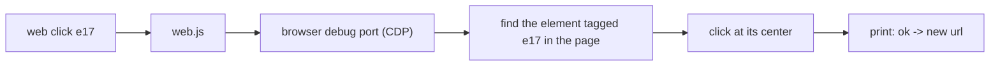

# web-agent-cli

**The CLI alternative to Playwright MCP, for the Chromium browser you actually use.**

Playwright MCP is great until you watch your agent use it: a full page snapshot after every click, thousands of tokens per step, a browser it launches itself, and no easy way to use the Opera you're logged into.

`web` does the same job as a plain command-line tool. Your agent calls it from the shell, it drives **Opera, Chrome or Edge** (any Chromium browser), and it prints only what the agent needs:

```
$ web goto news.ycombinator.com
ok https://news.ycombinator.com/ "Hacker News"
[e3 link "new"] [e4 link "past"] [e10 link "login"]
table 92x3:
  | 1. | [e12 link "Show HN: HackerBooks"] ( [e13 link "hackerbooks.org"] )
  |  | 1629 points by [e14 link "roansh"] | [e17 link "268 comments"]
  …+10 similar (web page --expand e231)

$ web click e17
ok -> https://news.ycombinator.com/item?id=50326821
```

Every clickable thing gets a short ref like `e17`. The agent reads the page, then says `click e17`. That's the whole idea.

## Why use it instead of Playwright MCP

| | Playwright MCP | web |
|---|---|---|
| Output after an action | Full page snapshot | One line (`ok`, or `ok -> new url`) |
| Reading a page | Accessibility tree dump | Compact outline, folded only when over budget |
| Browser | Its own Chromium, Firefox or WebKit | Your Opera, Chrome or Edge, with your logins |
| Setup | MCP server config | `npm i -g`, then just a shell command |
| Batching | One tool call per action | `web do` runs many steps in one call |

Pick Playwright MCP if you need Firefox or WebKit. Pick `web` if you want a lean agent loop on the Chromium browser you already use.

- **Fewer tokens.** You get compact text, not accessibility-tree dumps. A full HN front page is about 6k characters.
- **Keeps your PC usable.** It works while the browser is minimized and never moves your mouse.
- **Uses your logins.** `web clone` copies your logins from your normal browser profile into the agent's profile.
- **Zero dependencies.** One Node script. Requires Node 22 or later.

## Install

```
npm install -g github:Abedishere/web-agent-cli
web selftest          # should end with: selftest ok (20/20)
```

The first command opens a separate browser window that belongs to the agent. Your own windows and tabs are left alone.

## Commands

| Command | What it does |
|---|---|
| `web goto <url>` | Opens a page and prints its top part |
| `web page` | Prints the whole page as an outline with refs |
| `web page --region main` | Prints just one part (`main`, `nav`, `form`, `dialog`, or a ref) |
| `web find <text>` | Finds elements, e.g. `web find "Sign in"` or `web find button:Send` |
| `web click <ref>` | Clicks |
| `web type <ref> <text> [--enter] [--clear]` | Types into a field |
| `web select <ref> <option>` | Picks a dropdown option |
| `web key Enter` | Presses a key (`Tab`, `Escape`, `Control+a`, ...) |
| `web scroll [down\|up\|<ref>]` | Scrolls |
| `web wait <text\|ref\|url:part>` | Waits until something appears |
| `web text` | Plain page text |
| `web shot [ref]` | Saves a screenshot and prints the file path |
| `web eval <js>` | Runs JavaScript in the page |
| `web console` / `web net` | Errors and network requests, for debugging web apps |
| `web tabs` / `web open <url>` / `web back` | Tab and navigation basics |
| `web do` | Runs many commands in one call (one per line, from stdin) |
| `web clone [browser]` | Copies logins from your normal browser profile (close that browser first) |
| `web up [opera\|chrome\|edge]` | Picks the browser (default: Opera) |

Add `--b chrome` to any command to use a different browser for that one call.

## Using it from an agent

Tell your agent (in CLAUDE.md, AGENTS.md or a system prompt):

> For web tasks, use the `web` CLI. Start with `web goto <url>`, act on refs with `web click`/`web type`, and use `web find` instead of re-reading the whole page.

There's a ready-made Claude Code skill in [`SKILL.md`](SKILL.md).

## How it works



- The browser runs with a debug port, from its own profile folder in `~/.web-cli/profiles/`.
- Refs are stored on the page itself (`data-aref="e17"`), so they still work on the next command.
- A long page is folded only when it's over the size budget (8000 chars by default). `--expand` shows the folded part.

## Limits

- Opera, Chrome and Edge only. Firefox doesn't speak CDP.
- Doesn't look inside iframes or Shadow DOM yet.
- Tested on Windows. macOS and Linux need the browser paths added in `web.js`.

## License

MIT
